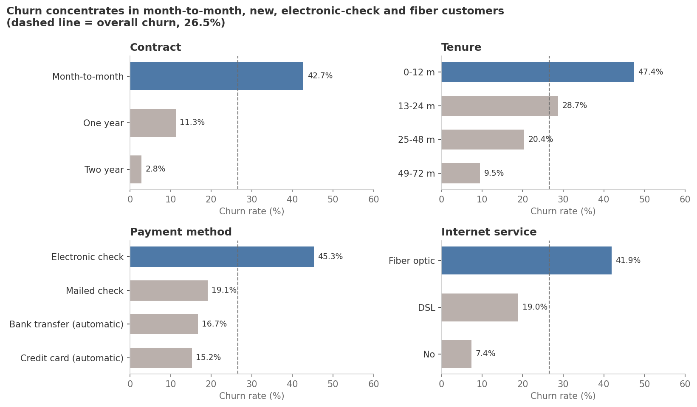
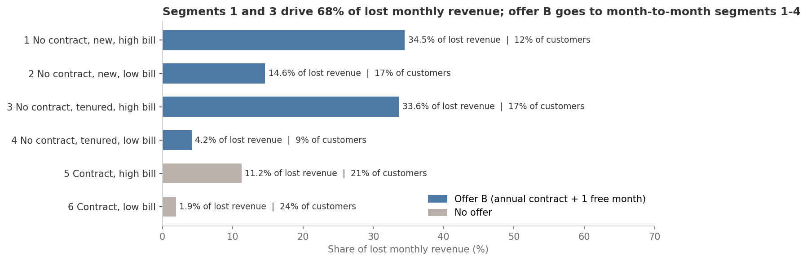
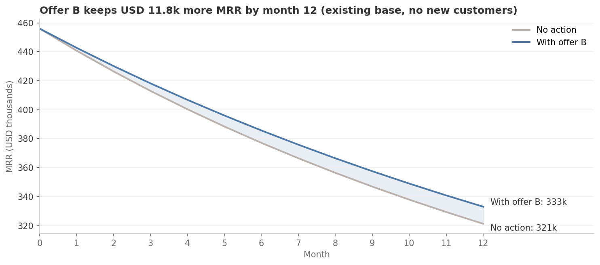

# Subscription retention & LTV: who to offer what, and what it is worth

## Answer
**Offer month-to-month customers an annual contract with one free month, and make no offer to customers who already have a contract.** This plan adds about **USD 48k** in expected lifetime value. A 15% discount for every month-to-month customer would lose about **USD 239k**. The plan pays off only if churn falls by about 23% among customers who accept the offer, so it should start as a randomized pilot.

**In plain words:**
- Two of six customer segments (29% of customers) account for 68% of the revenue lost to churn.
- Customers on contracts seldom cancel, so an offer to them would cost money without changing much.
- With only 25% of customers expected to accept, a pilot can confirm the assumed effect but not the break-even. Getting more customers to accept would make the test conclusive.

**Interactive dashboard:** [Subscription Retention & LTV on Tableau Public](https://public.tableau.com/app/profile/belen.shell.merier/viz/SubscriptionRetentionLTV/Executivesummary) · **One-page memo:** [MEMO.md](MEMO.md)

## Business question
A subscription business (here, a telecom operator) loses about a quarter of its customers every year. **Which subscribers should receive which retention offer, and how much is it worth?** Retention and lifecycle teams in streaming, telecom and SaaS companies make this decision regularly. A common mistake is to give the same discount to every customer at risk.

## Approach
1. **Data cleaning:** 11 blank `TotalCharges` all belong to customers with 0 months of tenure, so they are new sign-ups not billed yet (set to 0), not errors.
2. **Exploration (pandas + SQL):** churn by contract, tenure, payment method, monthly charge and internet service. The same question answered in SQL with DuckDB.
3. **Segmentation:** six segments built to be homogeneous in risk and value, different from each other and actionable. Month-to-month customers are split by tenure (new = 12 months or less) and value (bill above the median of USD 70.35); contract customers by value only.
4. **Logistic regression:** what explains churn, read as odds ratios with 95% confidence intervals and a multicollinearity check (VIF).
5. **Discounted LTV by segment**, with CAC and payback.
6. **Decision model:** the expected value of three offers in each segment, with eligibility rules and one offer per segment.
7. **Sensitivity and break-even:** what happens if the offers work less (or more) than assumed.
8. **Pilot sample size:** a power analysis for the randomized test.
9. **KPI scorecard and 12-month MRR forecast**, and the export for the Tableau dashboard.

## Results
| KPI | Value |
|---|---|
| Customers | 7,043 |
| Annual churn | 26.5% |
| MRR | USD 456,117 |
| Monthly ARPU | USD 64.8 |
| Gross revenue retention (GRR) | 69.5% |
| Weighted average LTV | USD 1,066 |
| LTV / CAC | 3.6 |

- **Who leaves:** month-to-month customers churn 42.7% a year versus 2.8% on two-year contracts; customers in their first year, 47.4%; electronic-check payers, 45.3%; fiber customers, 41.9%. In SQL: month-to-month customers paying by electronic check are 1,850 customers with 53.7% churn and 30.4% of revenue.
- **Logistic regression (pseudo R² 0.274):** a two-year contract goes with 74% lower odds of churn (odds ratio 0.26), a one-year contract with 49% lower odds (0.51), each extra year of tenure with 32% lower odds (0.68) and each extra USD 10 of monthly charge with 12% higher odds (1.12). These are associations, not causal effects: customers choose their contracts.
- **Where revenue is lost:** segments 1 and 3 (month-to-month, high bill) are 29% of customers and 68% of lost monthly revenue. Segment 6 (contract, low bill) is 24% of customers and 1.9%.

| Segment | Customers | Annual churn | LTV (USD) | Decision | Break-even churn cut |
|---|---|---|---|---|---|
| 1 Month-to-month, new, high bill | 812 | 70.0% | 490 | Offer B | 24.5% |
| 2 Month-to-month, new, low bill | 1,182 | 38.6% | 487 | Offer B | 21.7% |
| 3 Month-to-month, tenured, high bill | 1,231 | 41.5% | 1,017 | Offer B | 21.5% |
| 4 Month-to-month, tenured, low bill | 650 | 18.5% | 858 | Offer B | 28.7% |
| 5 Contract, high bill | 1,472 | 10.7% | 2,125 | No offer | – |
| 6 Contract, low bill | 1,696 | 3.3% | 944 | No offer | – |

**Offers compared** (assumptions, stated in the notebook):

| Offer | Take-up | Churn cut among acceptors | Eligible |
|---|---|---|---|
| A: 15% discount for 12 months | 100% | 20% | everyone |
| B: annual contract + 1 free month | 25% | 40% | month-to-month only |
| C: free support and security for 12 months (USD 36) | 60% | 15% | everyone |

- **Decision:** offer B in segments 1-4 and no offer in 5-6: **+USD 47.9k** of expected lifetime value. A 15% discount for every month-to-month customer: **-USD 238.6k**. Both are compared with doing nothing.
- **Break-even:** offer B pays off if churn falls by about 23% among acceptors (22-29% depending on the segment), against an assumed 40%.
- **Sensitivity:** offer B still wins if it works at 75% of the assumed strength (+USD 19.9k); at 50% or less, no offer pays. Take-up changes the size of the result, not its sign.
- **12-month forecast (existing base, no new customers):** MRR falls from USD 456k to 321k without action and to 333k with offer B (+USD 11.8k per month by month 12). After the cost of the free month (about USD 64k), the net gain in year one is about USD 34k.

## Pilot design
- The break-even is a 22.9% churn reduction among customers who accept (pooled across segments 1-4). A randomized test compares everyone *offered* the deal with a control group, and with 25% take-up the difference it can observe is only 5.7% (42.7% vs 40.3% churn).
- Detecting that difference needs **12,722 customers** (two-sided, α = 0.05, power = 0.80); there are 3,875 eligible. Adding new sign-ups (about 166 per month) would take about 53 months.
- With all eligible customers split 50/50, the test can detect a reduction of about 41% among acceptors, close to the assumed 40%. At 50% take-up, about 1,600 customers per group would be enough.
- **Duration:** churn is measured over a year, so the result is read at 12 months. Contract conversions and monthly churn are tracked every month as early signals.
- **Recommendation:** run the pilot with all eligible customers, test channels and messages to raise take-up at the same time, and read a non-significant result as "the effect is below about 40%", not as proof that the offer fails.

## Decision memo
The one-page memo for the board is in [MEMO.md](MEMO.md). In short:
- **Recommendation:** annual contract + 1 free month for month-to-month customers; no offer for contract customers; no blanket discount.
- **Risks:** the plan needs churn to fall by about 23% among acceptors; churn is read as annual; take-up, effectiveness, margin, discount rate and CAC are assumptions.
- **Measurement:** a 12-month randomized pilot with a control group, the same approach as my [A/B test case study](https://github.com/belen-shell-merier/ab-test-freemium-gate).

## Key assumptions and limitations
- **Churn period:** the dataset says churners "left within the last month", but read literally that gives an average customer life of 3.8 months against an average tenure of 32.4 months. I treat the churn flag as annual and flag it as the main limitation: if it were monthly, every LTV would be much lower.
- **LTV inputs:** 60% gross margin, 10% annual discount rate, 60-month horizon and a hypothetical CAC of USD 300.
- **Snapshot data:** one point in time with no dates, so tenure groups are not real sign-up cohorts.
- **Associations, not causes:** the logit describes who churns; the causal effect of an offer can only come from the pilot.
- **Simplifications:** a saved customer is valued at the segment-average LTV, churn is constant over time and offers are not combined. Cannibalization between offers is measured in a later project.
- **Multicollinearity:** monthly charge and internet type have VIFs of 9.2-9.6 (the bill depends on the internet plan), so their odds ratios are less precise; contract and tenure, which drive the recommendation, are below 3. `TotalCharges` (VIF 10.4) is left out.

## How I used AI
I directed the analysis; Claude Code handled the execution. I defined the question and scope, made every analytical decision (data cleaning, segmentation, LTV and offer assumptions, test parameters and the final recommendation) and set the checks the results had to pass. Claude Code wrote and ran the code, built the Tableau dashboard and drafted the text, which I reviewed and edited.

- **Checks:** key numbers recomputed independently from the raw data, and the notebook re-run from scratch.
- **What they caught:** an uncited churn definition, an offer applied to ineligible customers, rounding before later calculations and fragile code, all fixed. The power analysis later showed the pilot could not detect the break-even, which changed the measurement plan.

## Files
- [`subscription_retention_ltv.ipynb`](subscription_retention_ltv.ipynb): the full analysis, step by step.
- [`MEMO.md`](MEMO.md): the one-page decision memo.
- `data/WA_Fn-UseC_-Telco-Customer-Churn.csv`: the raw data.
- `tableau/`: the three tables exported for the dashboard.
- `charts/`: the charts shown above.

**To run it:** open the notebook in Google Colab and run all cells. It reads the data straight from this repository, with no upload needed.

## Tools
Python (pandas, NumPy, statsmodels, matplotlib) · SQL (DuckDB) · Tableau Public · Google Colab

## Data
[Telco Customer Churn](https://www.kaggle.com/datasets/blastchar/telco-customer-churn) (IBM sample data, via Kaggle): 7,043 customers of a fictional telecom company, one snapshot.
